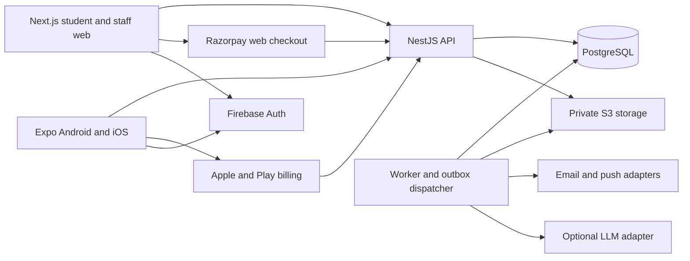

# System architecture

Authority: [decisions](DECISIONS.md); scope: [requirements](REQUIREMENTS.md). Proposed implementation, not deployed infrastructure.

> **Storage superseded (16 November 2026):** the owner chose SQLite for all server storage, including files and the job queue; see the SQLite decision in [DECISIONS](DECISIONS.md). PostgreSQL, pg-boss, S3 and multi-replica sections below predate that decision and have not been revised. Production hosting for a single-host SQLite deployment still needs its own design pass.

## Deployment shape



One codebase, independent HTTP/worker processes. PostgreSQL owns relational state, queue and outbox. Object storage holds binaries; SQLite/IndexedDB hold client durability, not independent server authority. Google Pub/Sub is a Play notification ingress dependency, not the domain job queue.

## Modules and ownership

| Module | Owns / exposes |
|---|---|
| identity | Firebase mapping, roles, registered devices, examiner profile/KYC, consent |
| catalogue | Exams/stages/syllabus/template versions, series/tests, discovery and follow |
| authoring | Drafts, question/group versions, asset validation, imports and samples |
| qc | Runs, flags, assignment, verdicts, reports and quarantine |
| attempts | Session lease, start/deadline, event ingestion and finalization |
| results | Immutable result revisions, aggregates, rank, corrections and progress |
| commerce | Orders, verification, entitlements, coupons, receipts/refunds |
| payouts | Append-only earnings ledger, reconciliation and payout allocation |
| notifications | Templates, delivery deduplication, preferences, retries |
| admin | Role-scoped orchestration, settings, banners, audit queries |

Modules expose service contracts; do not query another module's tables from controllers. Cross-module workflows use an application service and shared transaction context. Read projections may join approved views through a documented query service. Dependency direction: HTTP/jobs -> application services -> domain logic -> repositories/providers. No circular service dependencies.

## Package layout

```text
apps/api/src/{common,config,providers,modules,main.ts,worker.ts}
apps/web/{app,src/features,src/lib,src/ui}
apps/mobile/{app,src/features,src/lib,src/ui}
packages/contracts/src/{identity,catalogue,authoring,qc,attempts,commerce}
packages/engine/src/{reducer,timing,scoring,sections}
packages/db/{prisma,migrations,seeds}
```

Contracts contain no database/vendor imports. Engine has no React, HTTP, clock, or storage effects. DB never imports apps. Web and mobile share domain contracts/engine, not platform-specific components. Use ready accessible primitives and a small token layer, not a bespoke UI framework.

## Transaction and event rules

Every business mutation validates access and state in a transaction. Append audit + outbox atomically. Dispatcher locks outbox batches, sends pg-boss jobs, then marks dispatch; crash between send/mark may duplicate. Consumer applies domain change and inserts unique `(consumer,event_id)` receipt in one transaction. External calls run outside long database transactions and use deterministic idempotency identifiers with reconciliation.

Jobs: `qc.run`, `content.publish`, `attempts.finalise`, `results.score`, `results.rescore`, `rank.rebuild`, `commerce.fulfil`, `commerce.invoice`, `commerce.reconcile`, `payouts.calculate`, `notifications.send`, `identity.delete`. Retry with bounded backoff, dead-letter/failed state, operator replay and immutable event identifiers.

## State transitions

| Entity | Allowed transitions |
|---|---|
| Test | draft -> submitted -> in_qc -> changes_requested or approved; changes_requested -> submitted; approved -> publishing -> scheduled/live; scheduled -> live; live -> archived |
| Publication | pending -> artifact_ready -> live; failure remains nonpublic and retriable |
| Attempt | in_progress -> submitted or auto_submitted; scoring pending -> ready/failed separately |
| Order | created -> pending -> paid; created/pending -> failed/expired; verified late success reconciled; paid -> refund_pending -> refunded |
| Payout | calculated -> held or approved; held -> calculated; approved -> processing -> paid/failed |

Availability is separate from lifecycle: a live paper may be quarantined. Publishing pins question/group/template versions; only expose when the key-free artifact is ready. A scheduler is idempotent. Approved tests cannot bypass unresolved blocking QC rules.

## Capacity and failure boundaries

Private paper artifacts offload downloads. Answer batches every 5s when dirty: 5,000 dirty clients imply 1,000 requests/s, before retries/start/submit bursts. Use jitter and indexed writes; load test actual event counts and full test duration. Avoid full-corpus trigram scans on request paths; bound candidates and run expensive precheck asynchronously.

Start single always-on host with managed PostgreSQL; then separate worker, multiple stateless API replicas, and measured read projections. Multi-instance throttling uses shared PostgreSQL counters or edge limits, not isolated memory counters. Redis requires a documented measured need and architecture decision. Never claim a free host meets live-window availability.
